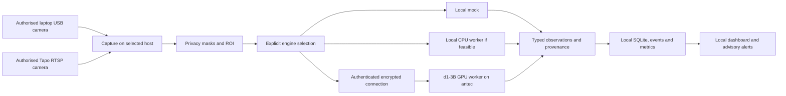

# Phase 4 proposal — GPU worker and live-camera pilot

Status: **implementation authorised** by the owner on 13 October 2026: “Implement this Phase.”
Model/runtime feasibility and the scoped worker/dashboard/camera software are authorised.
Actual camera endpoints/credentials still require local owner provisioning; existing workloads,
OS/driver changes and unattended service deployment need their separate explicit approval.

15 October operator-workflow update: the owner explicitly authorised VOP to pause Antec's
other GPU workload automatically when inference is needed and restore it after a timed session.
This covers on-demand recovery and the existing foreground app's configured sampling, not OS
autostart, permanent services or Phase 5 deployment. Normal desktop use reuses saved setup,
automates local sign-in and hides manual controls under advanced settings.

15 October interface update: the owner requested distinct camera and engine creation, editing
and use pages. Named engine profiles use the existing protected-worker contract and settings
store. Saving a profile does not select it; Use engine is explicit. This is Phase 4 operator
workflow work, not a new model installation or Phase 5 deployment.

## Outcome

A local browser dashboard can evaluate captured images using the explicitly selected backend:
mock, a capable local CPU installation, or the pinned d1-3B model on an authenticated antec GPU
worker. The first supported Tapo camera can traverse capture → privacy/ROI → remote inference
→ stored observations → events/metrics/alerts, with visible UNKNOWN on failures.

This is a narrow next-phase scope: authenticated inference workers (INF-011, NFR-017) plus
completion of real-camera acceptance on existing USB/RTSP adapters. It deliberately brings the
worker extension forward from the wider roadmap. It does not include the roadmap's entire
expanded-input catalogue or Phase 5 distributed scheduling/multi-user scale.

## Established baseline

- Phase 3 application code is merged. Existing capture/inference/measurement/UI separation,
  immutable versions, byte-oriented frames, privacy masks/ROI, default-off evidence and offline
  tests must be preserved. The CLI/dashboard currently selects configured mocks only.
- The earlier antec d1-3B benchmark used CPU FP32 and Torch's CPU wheel. It provides no GPU
  result. The temporary benchmark directory still existed at the last read-only check.
- The official checkpoint revision remains
  `051bcc464b01b9f92942b364d9586b0ef5912432`; changing the model, revision or model format
  is a separate explicit decision. Historical CPU reports/locks remain historical evidence.
- GPU inventory previously identified NVIDIA RTX 5060 Ti and AMD Radeon AI PRO R9700.
  Recheck inventory, drivers, free VRAM/RAM/disk and existing workloads before any test.
- USB capture was tested with mocked answers. Generic RTSP capture exists; authenticated Tapo
  credentials are not implemented. No Tapo/model accuracy test has been executed.

## Proposed topology

Default pilot: dashboard, storage and capture remain on the laptop; antec receives only the
preprocessed sampled image and its question specifications. The source host and inference host
stay independent. The worker interface also permits a worker on the same host for local CPU
execution. This does not require a common filesystem or model installation on the laptop.

## Milestone 1 — prove GPU feasibility on antec

1. Read current hardware/runtime inventory and the pinned model code's device handling. Inspect
   official runtime support before selecting dependencies; do not infer support from Vulkan.
2. Prefer one NVIDIA GPU through a compatible PyTorch CUDA runtime for the first feasibility
   experiment. Validate device architecture support and real model execution, not just successful
   imports or `cuda.is_available()`. AMD/ROCm is a separate candidate if needed; no Vulkan
   implementation is assumed. Do not pool VRAM across the two different GPUs.
3. Use a dedicated antec environment and durable owner-approved application/cache directories.
   Reuse verified cached weights where possible. Do not modify system Python, existing GPU
   services or drivers. Any required OS/driver change is reported before proceeding.
4. Run one authorised non-sensitive still-image request, then the established 1/3/5-question
   benchmark with first-call and at least three warmed repetitions. Verify parameters/tensors
   and actual GPU activity; record checkpoint, runtime, device, precision, latency, peak VRAM,
   host RAM and typed native outputs.
5. Choose precision only after a supported configuration actually runs. Any reduced-precision
   candidate must pass output-contract checks and be compared on labelled frames; record its
   runtime provenance. No speculative quantisation/conversion or silent CPU fallback.

Exit: a measured GPU result and reproducible dependency lock/runbook, or an honest GPU NO-GO.
CPU success cannot satisfy this GPU gate. If GPU execution fails, transport/capture can still
be tested with explicit mocks, but the live GPU pilot remains incomplete.

## Milestone 2 — authenticated worker and hard failure boundaries

1. Wrap the existing model adapter in a supervised process with a hard execution deadline.
   One model-loaded worker, one inference in flight, no unbounded queue. Refuse overload and
   discard expired work; report skipped samples. Kill/restart a stuck/crashed child without
   corrupting observations. Avoid restart storms after repeated OOM/model-load failure.
2. Define a small versioned request/response protocol: request ID, worker identity, source/frame
   IDs, capture UTC, encoded image bytes and digest/dimensions, full question/version/criteria,
   processing deadline and typed result/native provenance. Validate byte/pixel/question/body
   limits and response coverage. Never transport paths or accept arbitrary executable model IDs.
3. For the first two-host installation, prefer the existing verified SSH connection as an encrypted
   tunnel to a worker bound to antec loopback, with separate application authentication. Pin/verify
   host identity. No public worker/dashboard ports or disabled certificate/host-key checks.
   Direct LAN HTTPS can be a later transport choice if required, not a prerequisite here.
4. Bound idempotency/result-cache lifetime and size. A retry retains its request ID; reject the
   same ID with a different payload. Separate ROI groups must have distinct identities even
   when they share the original frame ID. Expired/late responses cannot overwrite live state.
   Preserve UTC and use monotonic time for local deadlines; detect excessive clock skew.
5. Persist no incoming image pixels on antec by default. Keep credential material out of argv,
   URLs shown to users, logs, exports and responses. Clear request buffers after processing.
   Return generic diagnostics with request IDs rather than credentials or frame contents.

Exit: laptop fixture → real antec GPU → validated typed response. Wrong credentials/identity,
network disconnect, expired result, process kill, timeout and OOM produce visible UNKNOWN/ERROR,
with a responsive dashboard and bounded resources. No automatic mock/CPU substitution.

## Milestone 3 — explicit dashboard engine configuration

1. Extend validated configuration with backend profiles and one selected engine, independent of
   source IDs. Preserve existing mock configurations and immutable observation provenance.
   Support local CPU worker configuration without requiring CUDA on the laptop.
2. Add native FastHTML settings for backend selection, capability/health check and a deliberate
   test request. Display worker identity, actual model revision, GPU/CPU device, precision, load
   status, latency and failures. Never call a configured-but-unreachable worker “ready”.
3. Keep worker and camera secrets in OS-protected stores; configuration/UI exports contain only
   references. Windows uses an OS-bound secret mechanism; antec uses appropriately protected
   service secret provisioning. Do not place persistent secrets in repository JSON/env files.
4. Require deliberate opt-in for model execution and remote transmission of live pixels, including
   when saved sampling controls resume. Changing an engine must not silently restart capture,
   send images elsewhere or reinterpret old results. Historical provenance records the engines
   that generated the observations, not the current selection.

Exit: switch deliberately between mock and remote real engine; old results remain correctly
labelled. Local CPU mode passes an actual test only on an independently verified capable host.
The Dell's earlier infeasibility is not a blocker and cannot be reported as local model success.

## Milestone 4 — one authenticated Tapo/USB camera pilot

Owner-selected camera models: **Tapo C200, C210 and C510W**. First query, verbatim:
**“Is there a human in the picture?”** Answer kind: **binary**.

Proposed rollout: one C200 first, then verify the same path on C210 and C510W individually.
If another model is available first, use it for the initial pilot without changing the intended
three-model validation scope. Success on one model is not evidence for the other two.
Hardware revisions, firmware, availability and authorised camera locations remain to be supplied.

The proposed positive criterion is at least one real person visibly present in the camera scene.
Agree treatment of people shown on screens/posters and mirror reflections before labelling the
accuracy set. This is presence detection, not identity, face recognition, tracking or people counts.
Use the existing confirmation policy for presence episodes; missed captures/failed inference
remain UNKNOWN and never establish “no human”. Do not turn model uncertainty into a negative
or assert an abstention capability that the provider has not demonstrated.

1. Obtain each model's hardware/firmware version and verify RTSP availability against official
   documentation. Use a dedicated camera account, distinct from the cloud/app account.
   The owner supplies credentials through local protected setup, not in chat or committed files.
2. Choose the capture host based on camera reachability and privacy needs. Add authenticated
   acquisition without weakening the existing exact host allow-list. Construct any required
   authenticated RTSP locator only inside the capture child; never expose it in command-line
   arguments or native diagnostics. Resolve credentials from the protected store.
3. Provide a deliberate connection-test action and one preview with masked regions. Start with
   one camera, one simple binary question and a conservative sampling interval selected from
   measured end-to-end latency. Continuous sampling stays off until explicitly started.
4. Send the masked/ROI image to antec after explicit backend selection and a capture/sampling
   action. The owner's 14 October usability update removes extra permission checkboxes; the
   labelled operator action supplies permission. Persist real model provenance and show
   the result/events/metrics. Evidence remains off unless separately enabled by the operator.
5. Disconnect/reconnect camera and worker separately. Verify UNKNOWN and reconfirmation,
   bounded retries, no fabricated negative closure and no duplicate episode/alert on recovery.

Exit: AT-01/02 real acquisition-to-real-inference pipeline demonstrated on the selected supported
hardware. A successful RTSP connection or a plausible answer alone is not accuracy validation.
Record separate capture/inference results for C200, C210 and C510W; explicitly mark any unavailable
model pending. Compare standard/high-quality streams if resolution materially changes detection
of distant people, keeping latency and bandwidth measurements alongside accuracy.

## Milestone 5 — acceptance, operational evidence and handoff

| Gate | Evidence required |
|---|---|
| P4-01 | Actual pinned d1-3B GPU execution and repeatable 1/3/5-question measurements; device/runtime/precision/VRAM/RAM recorded. |
| P4-02 | Real laptop-to-antec request and provenance; encrypted authenticated link, bounded bodies, ROI-aware request identity and replay/deadline checks. |
| P4-03 | Hard worker timeout/kill/OOM/disconnect recovery; UNKNOWN, no unsafe fallback, responsive dashboard, bounded concurrency/cache. |
| P4-04 | Explicit engine configuration/health/test UI; source independence; old configs migrate safely and old observations retain provenance. |
| P4-05 | Authorised USB and/or supported Tapo pilot with protected credentials, allow-list, privacy-before-transmission and default-off retention. Specific untested hardware remains pending. |
| P4-06 | Owner-approved labelled human-present/human-absent/difficult frames for C200, C210 and C510W; record per-camera false positives/negatives, unknown rate and end-to-end latency. Include distant/partially occluded people, empty scenes, shadows, reflections, screen/poster people, low light/IR and motion blur as applicable. Use-case targets and ambiguous-case labels agreed before claiming adequate accuracy. |
| P4-07 | 60-minute bounded-load/overload test (NFR-003), worker termination and restart/replay tests; measure queue/drop counts, RAM/VRAM and responsiveness. Live soak requires live-capture authorisation. |
| P4-08 | Offline transport/auth/replay/camera-secret tests without weights/cameras/secrets; Windows/Linux CI, real browser configuration QA, private runbook and actual-hardware evidence. |

First implementation PRs should remain reviewable: GPU feasibility/adapter; worker/transport;
dashboard profiles; camera credentials/pilot; final validation. No automatic merges. Backend
versions are pinned after installation/execution verification, not selected by guesswork now.

Final recommendation is GO / CONDITIONAL GO / NO-GO with measured facts. A missing camera,
incompatible GPU or absent labelled workload is a pending/failed gate, not fabricated success.
Installation instructions include tunnel startup, worker health, key rotation, model cache,
sampling limits, rollback and stopping/removing the worker. No unattended startup/service change
is made without explicit owner deployment authorisation.

## Exclusions and open decisions

- No automatic ONVIF discovery/PTZ, HLS/MJPEG expansion, remote USB agents, OCR/tracking,
  fleet scheduling/failover, SSO/PostgreSQL, model conversion, GPU pooling or additional detectors.
- No application licence decision or production/safety certification. Do not automatically enable
  existing optional webhooks for a newly connected live model/camera; external actions stay opt-in.
- Confirmed pilot inputs: C200, C210, C510W; binary question “Is there a human in the picture?”
  Still needed: hardware/firmware versions, availability, authorised capture locations and
  non-sensitive labelled examples. Private IPs/credentials are supplied locally at implementation.
- Sampling/capacity/latency targets follow the actual benchmark (NFR-018). Avoid arbitrary promises
  of real-time video or a camera count before measurement.

## Primary references

- Repository `SRS-v0.2.md`: INF-001–009/011, INP camera/credential/privacy requirements,
  NFR-001–004/007/009/013/017–018, AT-01/02/03/05/08/09/10/12.
- [PyTorch installation/runtime selection](https://pytorch.org/get-started/locally/): verify the
  supported CUDA/ROCm combination during feasibility; this is not proof of d1-3B compatibility.
- [Tapo RTSP/ONVIF setup](https://www.tapo.com/en/faq/34/) and
  [camera account guidance](https://dev.tapo.com/en/faqs/tapo-camera-account-how-to-create-change-or-delete-it/).
- Existing Phase 0 antec report and pinned Liquid adapter: historical CPU facts only.
