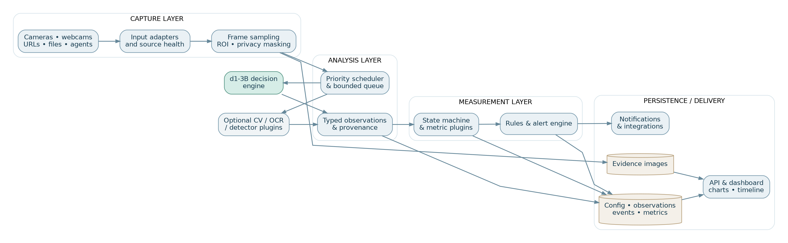
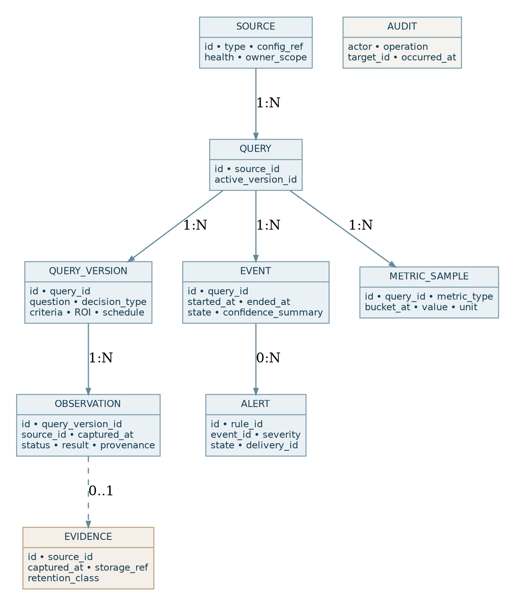
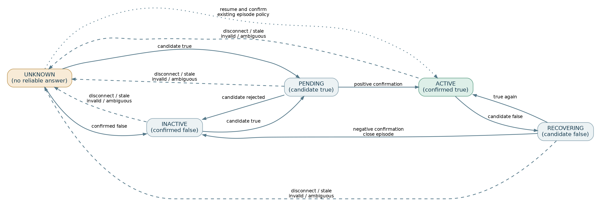

# Visual Observability Platform

**Software Requirements Specification (SRS)**  
**Version:** 0.2 — Codex-ready specification baseline  
**Date:** 13 October 2026  
**Status:** Reviewed for Phase 0 implementation; full MVP remains a planned, unimplemented scope  
**Product name:** Working title; not a branding decision  
**Deployment philosophy:** Local-first, modular, privacy-by-design  
**Primary audience:** Product owner, implementers, testers, security and information-governance reviewers

> **Document status.** This is a development baseline, not proof that the proposed product, model combinations, camera integrations or workplace deployments have been validated. Requirements labelled **MVP** establish the initial delivery scope; **Later** requirements establish intended extension points. Formal approval, accuracy testing and any applicable DPIA remain separate activities. **For the immediate coding task, `CODEX_PHASE_0.md` is the controlling scope and exit-gate contract. Phase 0 is a small feasibility study, not delivery of the MVP.**

## Document control

| Item | Value |
|---|---|
| Document ID | VOP-SRS-001 |
| Revision | 0.2 |
| Classification | Design proposal with executable Phase 0 companion contract; not operational policy |
| Authoring basis | Product discussion through 13 October 2026, plus sources in §18 |
| Intended source of truth | This Markdown file in version control; `.docx` is an editable review edition |
| Change policy | Record accepted changes, affected requirement IDs and rationale in `CHANGELOG.md`; see `CODEX_PHASE_0.md` for the immediate task |

## Contents

1. Executive summary  
2. Scope, boundaries and assumptions  
3. System context and users  
4. Functional requirements  
5. Non-functional requirements  
6. Architecture and component responsibilities  
7. Core information model  
8. Decision and measurement semantics  
9. Plugin interfaces and compatibility contracts  
10. User journeys and information architecture  
11. Security, privacy and governance  
12. Technical design choices and rationale  
13. API sketch and configuration example  
14. Verification, acceptance and traceability  
15. Phased implementation roadmap  
16. Risks and mitigations  
17. Open decisions and change control  
18. Sources and verification notes  
Appendix A. Phase 0 implementation handoff and acceptance hierarchy

## 1. Executive summary

### 1.1 Purpose

The Visual Observability Platform (VOP) shall convert visual sources into **user-defined, timestamped observations** and then into events, measurements, alerts and explanatory dashboards. A user selects a camera or other input, supplies one or more questions, chooses how answers should be measured, and reviews current conditions and historical evidence. A source can support many independent questions; each question can drive many measurements and outputs.

The platform is **not** a replacement for a CCTV recorder, a certified fire or flood alarm, a safety controller, or a clinical decision system. It provides supplementary observational intelligence. The initial inference backend is Liquid AI's **d1-3B**, but the software shall remain model-agnostic.

### 1.2 Product goals

1. Make existing cameras and image sources usable as configurable visual sensors.
2. Let non-programmers define observations in ordinary language.
3. Convert repeated decisions into robust states, counts, frequency, duration and trends.
4. Preserve enough provenance to explain and audit every significant event.
5. Run locally without mandatory cloud services; scale through optional processing workers.
6. Separate input, inference, measurement, rule and presentation implementations.
7. Prioritise least-privilege access, bounded retention and safe workplace deployment.

### 1.3 Representative use cases

| ID | Setting | User question | Derived value |
|---|---|---|---|
| UC-01 | Home / Tapo | Is a fox visible in the garden? | Visits per day, visit duration, evidence gallery |
| UC-02 | Home / entrance | Is a parcel present in the marked doorstep area? | Arrival and disappearance events |
| UC-03 | Server room | Is visible water present beneath rack A? | Water-detection episode and urgent review alert |
| UC-04 | Server room | Is cabinet door 4 open? | Duration open, event history, persistence alert |
| UC-05 | IT workshop | Is a marked walkway obstructed? | Percentage of working hours obstructed |
| UC-06 | Legacy equipment | Is the UPS indicator green, amber or red? | Time spent in each state and changes |

### 1.4 Success conditions

The MVP will be considered successful when a user can connect at least one supported camera or image source, configure two or more independent questions, produce saved observations and derived events, review linked snapshots and charts, and recover correctly after source disconnection and service restart. Acceptance shall use replayable reference media as well as a real camera. The model's classification accuracy must be measured; it shall **not** be assumed from published model benchmarks.

## 2. Scope, boundaries and assumptions

### 2.1 In scope for MVP (later release, not Phase 0)

- Local Windows 11 development and operation; an optional Linux deployment profile.
- Image files, video files, HTTP(S) snapshot URLs, RTSP streams and a locally attached USB webcam.
- Configurable per-source sampling, test connection, health status and restricted regions of interest (ROI).
- User-supplied binary, named-choice and ordinal questions using d1-3B when available.
- A model-neutral inference interface and explicit error/unknown outcomes.
- Persistence-aware binary state tracking, event counts, estimated durations, frequency and basic trends.
- Dashboard with source status, latest answers, timelines, charts, events and optional evidence images.
- Local user accounts and role-based controls; authenticated web access.
- Per-source retention, export of tabular results, audit trail and basic notifications.
- Importable test datasets for deterministic system testing.

### 2.1.1 Explicit Phase 0 boundary

Phase 0 implements only a still-image input adapter, typed inference contracts, a clearly labelled deterministic mock engine, an **optional and explicitly initiated** d1-3B CPU benchmark, and offline tests/documentation. No React dashboard, database, RTSP streaming, background surveillance, live alerts or workplace deployment is authorised by this handoff. Real-model memory failure is an acceptable finding if accurately reported. See `CODEX_PHASE_0.md`, `AGENTS.md` and ADR-0001.

### 2.2 Future or conditional scope

- ONVIF discovery, profiles and PTZ controls; network capture agents for remote USB devices.
- MJPEG, HLS, WebRTC, RTMP, SRT, RTP, NVR and proprietary/cloud-only camera adapters where technically and contractually available.
- Specialist object detection/tracking, OCR, visual differencing, counting and multimodal audio engines.
- Multi-worker inference, central PostgreSQL, SSO, granular tenancy and distributed observability.
- Advanced correlations, rules across sources, configurable report generation and alert integrations.
- User-installable dashboard widgets and documented third-party plugin packaging.

### 2.3 Explicit exclusions

- Guaranteed interoperability with every camera, URL or codec; source availability depends on protocol and manufacturer restrictions.
- Automatic identification of people, facial recognition, emotion inference, employee productivity scoring or covert staff surveillance.
- Medical, diagnostic, fire, electrical or flood safety certification.
- Default continuous recording and archiving of all camera footage.
- Autonomous control of physical safety systems in the MVP.
- Claiming that a model score is automatically a calibrated probability of a real-world event.

### 2.4 Assumptions and dependencies

| Ref | Assumption or dependency |
|---|---|
| A-01 | The initial test laptop has Windows 11, i5-10310U, 16 GB RAM and no required discrete GPU. Inference feasibility is an open gate. |
| A-02 | The user has administrative permission to connect each camera; its documented protocol is actually enabled. |
| A-03 | A camera image is not proof that an apparently closed door is locked or that an unseen area is safe. |
| A-04 | Some user questions cannot be answered reliably by the selected model; the UI must make this visible. |
| A-05 | Work deployments need local organisational approval, privacy assessment and network/security review. |
| A-06 | Tapo RTSP/ONVIF availability differs by model and power mode; see [SRC-02]. |

## 3. System context and users

### 3.1 Roles

| Role | Typical privileges |
|---|---|
| Owner / system administrator | Configure deployment, users, permissions, models, retention and integration secrets. |
| Operator | Register authorised sources, create queries, test rules and acknowledge alerts. |
| Viewer | See authorised dashboards and evidence without changing configuration. |
| Auditor | Read configuration revisions, alerts and audit records within approved scope. |
| Processing worker | Machine identity restricted to capture/inference/storage actions explicitly granted. |

One person may have several roles. Work installations may require additional departmental boundaries. All denied access attempts shall be audited without copying sensitive credentials.

### 3.2 Terminology

| Term | Definition |
|---|---|
| Source | An addressable image/video producer or imported file. |
| Query | User-defined question associated with a source and an answer contract. |
| Query version | Immutable version of text, criteria, ROI and evaluation policy. |
| Observation | Timestamped inference result or explicit unknown/error for one query version. |
| State | Derived current condition such as inactive, pending, active or unknown. |
| Event / episode | Time-bounded confirmed condition or significant state transition. |
| Metric | Computed measure, such as duration, event count or occupancy. |
| Evidence | Retained original/cropped frame or clip associated with an observation/event. |
| Adapter | Plugin that exposes a source or processing capability through a contract. |
| Rule | User-configured logic that evaluates states/metrics and may trigger an action. |

## 4. Functional requirements

**Scope note:** The requirements below describe the first **complete MVP release**, not the immediate Codex Phase 0 assignment. For Phase 0, use `P0-01`–`P0-10` in `CODEX_PHASE_0.md` and stop at its exit gate.

**Notation:** **MVP** means required for first release. **Later** means supported by the architecture but not required in the first release. Each row includes a directly testable acceptance condition; fuller integration scenarios appear in §14. Unless indicated otherwise, all requirements use “shall”.

### 4.1 Source acquisition and health

| ID | Phase | Requirement and acceptance condition |
|---|---|---|
| INP-001 | MVP | Register sources with unique ID, friendly name, type and authorised owner scope; reject duplicate IDs. |
| INP-002 | MVP | Open a permitted RTSP stream and obtain a timestamped frame; prove using a test camera or RTSP fixture. |
| INP-003 | MVP | Poll an HTTP(S) JPEG/PNG snapshot URL with configured timeout; show success or error. |
| INP-004 | MVP | Capture an image from a locally attached supported USB webcam; enumerate devices and preview one. |
| INP-005 | MVP | Import still images and video files without modification to originals; preserve source metadata. |
| INP-006 | MVP | Validate connection parameters and offer “Test connection”; no test shall require saving a question. |
| INP-007 | MVP | Expose CONNECTING, HEALTHY, DEGRADED, DISCONNECTED and DISABLED source states with last-success time. |
| INP-008 | MVP | Retry transient acquisition failures with capped exponential backoff; a disconnected source shall not generate fabricated negative answers. |
| INP-009 | MVP | Permit a per-source polling/sampling schedule and enforce a global backpressure limit. |
| INP-010 | MVP | Support image rotation, optional resize, one or more ROI rectangles and privacy masks before inference/storage. |
| INP-011 | MVP | Keep credentials out of displayed stream URLs, logs, export files and browser API payloads. |
| INP-012 | Later | Discover and test compatible ONVIF Profile S/T devices without assuming all discovery devices are supported. |
| INP-013 | Later | Add remote agents and protocol adapters without changing core observation storage. |
| INP-014 | Later | Support motion/event-triggered capture when upstream hardware or an adapter provides reliable events. |

### 4.2 User questions and decision contracts

| ID | Phase | Requirement and acceptance condition |
|---|---|---|
| QRY-001 | MVP | Allow multiple active queries per source; demonstrate at least three configured queries on one frame. |
| QRY-002 | MVP | Let users enter, validate, edit, enable and disable their own question text. |
| QRY-003 | MVP | Support `binary` (yes/no), `choice` (named categories) and `ordinal` (2–10 ordered levels) answer contracts. |
| QRY-004 | MVP | Require named options and meanings for `choice`; require ordered level descriptions for `ordinal`. |
| QRY-005 | MVP | Store each saved edit as a new immutable query version; old observations continue to reference the prior version. |
| QRY-006 | MVP | Support optional ROI per query and display the ROI overlay in previews and retained evidence. |
| QRY-007 | MVP | Support per-query threshold, required confirmations, evaluation frequency and unknown-state policy. |
| QRY-008 | MVP | Provide a “Test question” action that shows the input image, raw model output, derived label and elapsed time. |
| QRY-009 | MVP | Mark unsupported questions/capabilities as unsupported rather than silently approximating measurements. |
| QRY-010 | MVP | Allow query configuration export/import as versioned JSON with schema validation and secret redaction. |
| QRY-011 | Later | Supply reusable question templates and organisation-approved question catalogues. |
| QRY-012 | Later | Support multi-source composite queries with explicit temporal alignment semantics. |

### 4.3 Inference and model management

| ID | Phase | Requirement and acceptance condition |
|---|---|---|
| INF-001 | MVP | Support a provider-neutral inference adapter with machine-readable supported input/answer capabilities. |
| INF-002 | MVP | Implement a d1-3B adapter using the documented `system_one` question and answer shapes (see [SRC-01]); test against official example fixtures. |
| INF-003 | MVP | Group compatible questions for one captured image in a single inference request when model/runtime permits. |
| INF-004 | MVP | Emit typed results for binary, choice and ordinal answers without conflating `noul`, `confidence` and `probabilities`. |
| INF-005 | MVP | Record model ID/version, query version, source/frame references, execution duration and processing status for each result. |
| INF-006 | MVP | Enforce a bounded work queue; drop or coalesce stale periodic frames under overload, with auditable skip counters. |
| INF-007 | MVP | On timeout, OOM, decode failure or model absence, return UNKNOWN/ERROR and preserve system availability. |
| INF-008 | MVP | Provide CPU-only configuration without requiring CUDA; perform a documented RAM/latency feasibility benchmark on the reference Dell. |
| INF-009 | MVP | Make thresholds configurable and clearly describe scores as uncalibrated unless a specific detector has been calibrated. |
| INF-010 | Later | Enable specialist detection, OCR and tracking engines behind the same capability negotiation layer. |
| INF-011 | Later | Support process-isolated or remote inference workers with authenticated communication. |
| INF-012 | Later | Store validation datasets and detector performance by source/task for threshold tuning. |

### 4.4 Measurement and temporal processing

| ID | Phase | Requirement and acceptance condition |
|---|---|---|
| MET-001 | MVP | Normalise every evaluated sample to POSITIVE, NEGATIVE, UNCERTAIN or ERROR plus raw provider answer. |
| MET-002 | MVP | Expose INACTIVE, PENDING, ACTIVE, RECOVERING and UNKNOWN state transitions with configurable confirmation policy. |
| MET-003 | MVP | Count a new event only after activation confirmation; rapid repeated positive samples shall not inflate count. |
| MET-004 | MVP | Measure duration from timestamped confirmed transitions and distinguish observed from estimated/unobserved time. |
| MET-005 | MVP | Produce count per selected calendar bucket and rate per interval, including zero versus missing-data distinctions. |
| MET-006 | MVP | Calculate occupancy proportion with explicit eligible observation time as denominator. |
| MET-007 | MVP | Compute category dwell time for named-choice answers; define handling of unknown intervals. |
| MET-008 | MVP | Provide time-series trend charts for ordered results without treating ordinal levels as physical units. |
| MET-009 | MVP | Use UTC timestamps internally and display user-selected timezone; define daylight-saving and late-frame behaviour. |
| MET-010 | MVP | Preserve unknown gaps after source failure; shall not silently close or extend events as if the scene were observed. |
| MET-011 | MVP | Recalculate metrics deterministically by replay of stored observations and query-version policy. |
| MET-012 | Later | Add specialist distinct-object tracking, exact counts and cross-camera deduplication where supported by a tracker. |
| MET-013 | Later | Add anomaly baselines, physical numeric readings, correlations and sequences as measurement plugins. |

### 4.5 Events, rules and notification delivery

| ID | Phase | Requirement and acceptance condition |
|---|---|---|
| EVT-001 | MVP | Record event start/end, query version, confidence summary, source and linked evidence IDs. |
| EVT-002 | MVP | Provide a chronological event log with search by source, type, severity and time range. |
| EVT-003 | MVP | Allow “condition active longer than X” and “count greater than N in interval Y” alert rules. |
| EVT-004 | MVP | Prevent duplicate alert delivery for one rule transition through stable idempotency keys. |
| EVT-005 | MVP | Support alert severity, acknowledgement, resolution and operator notes with audit history. |
| EVT-006 | MVP | Provide in-dashboard notifications; allow an optional outbound email/webhook channel only after explicit configuration. |
| EVT-007 | MVP | Retry failed deliveries with capped limits and surface delivery failure in the UI. |
| EVT-008 | MVP | Distinguish detection alerts from source-offline and processing-degraded alerts. |
| EVT-009 | Later | Support multi-source correlations and rule dependencies. |
| EVT-010 | Later | Allow action plugins subject to allow-listing, authorisation and dry-run safety checks. |

### 4.6 Dashboard, history and exports

| ID | Phase | Requirement and acceptance condition |
|---|---|---|
| UI-001 | MVP | Provide responsive browser navigation: Sources, Questions, Live Status, Events, Metrics and Settings. |
| UI-002 | MVP | Display a source card with last frame time, connectivity, configured queries and processing health. |
| UI-003 | MVP | Show latest result, state, last-observed time and clear UNKNOWN indication per query. |
| UI-004 | MVP | Display counts, estimated durations and time-series charts for a selected range. |
| UI-005 | MVP | Link an event/graph point to evidence snapshot when evidence was retained and viewer has permission. |
| UI-006 | MVP | Present event detail with source, question version, answer, threshold and provenance. |
| UI-007 | MVP | Allow dashboard filter by source, question, time period and severity. |
| UI-008 | MVP | Allow CSV/JSON export of permitted event and metric data with timezone and provenance fields. |
| UI-009 | MVP | Provide connection-test and query-test interfaces with diagnostic reasons rather than generic failure. |
| UI-010 | MVP | Show at least basic compute metrics: queue depth, model load status, inference time, skipped frames. |
| UI-011 | Later | Support drag/resize dashboard layouts, saved views, multi-user sharing and optional widget plugins. |
| UI-012 | Later | Provide scheduled reports and annotated comparative trend reports. |

### 4.7 Administration and operation

| ID | Phase | Requirement and acceptance condition |
|---|---|---|
| OPS-001 | MVP | Start capture/inference processing as a background service independent of an open browser. |
| OPS-002 | MVP | Persist all committed configuration, states and events across a clean restart. |
| OPS-003 | MVP | Expose structured service health, resource usage and error logs without credentials or image contents. |
| OPS-004 | MVP | Export/import configuration with schema version and compatibility checks. |
| OPS-005 | MVP | Backup and restore configuration, event data and referenced evidence consistently. |
| OPS-006 | MVP | Include first-run setup and a Windows-friendly development/installation guide. |
| OPS-007 | MVP | Offer controlled retention settings and a preview of expected deletion effects. |
| OPS-008 | MVP | Migrate database schema forward with rollback/backup guidance; never silently discard recorded events. |
| OPS-009 | Later | Package a production Linux/Docker Compose distribution. |
| OPS-010 | Later | Support processing workers across hosts and central scheduling/failover. |
| OPS-011 | Later | Integrate external identity providers and organisation group mapping. |
| OPS-012 | Later | Add signed plugin packages and managed plugin lifecycle. |

## 5. Non-functional requirements

| ID | Phase | Requirement / validation |
|---|---|---|
| NFR-001 | MVP | Local-first: core acquisition, inference, processing and dashboard shall operate without internet after installation and model download. |
| NFR-002 | MVP | No silent data loss: every skipped evaluation due to overload shall be counted with a reason. |
| NFR-003 | MVP | Queue memory use shall be bounded by documented configuration limits and verified in a 60-minute overload test. |
| NFR-004 | MVP | System shall restart after a killed processing worker without corrupting durable event records; simulate forced termination. |
| NFR-005 | MVP | All persisted timestamps shall include UTC instants; UI shall render local time correctly across UK DST changes. |
| NFR-006 | MVP | Admin HTTP endpoints shall require authentication; unauthorised access returns denial and audit entry. |
| NFR-007 | MVP | Source credentials shall be stored via a protected secret mechanism, not in plaintext configuration exports. |
| NFR-008 | MVP | HTTPS shall be required for non-loopback dashboard sessions in production deployments. |
| NFR-009 | MVP | Imported URLs shall be checked against explicit allow-lists/network restrictions to prevent server-side request forgery (SSRF). |
| NFR-010 | MVP | Operators shall be able to configure evidence off and delete retained images independently of derived metrics. |
| NFR-011 | MVP | UI shall support keyboard interaction, descriptive error messages and meaningful chart text alternatives. |
| NFR-012 | MVP | Installation shall document CPU, RAM, disk, OS and codec requirements from observed benchmark results, not guesses. |
| NFR-013 | MVP | Every event/metric shall retain a reference to query/model versions used to derive it. |
| NFR-014 | MVP | All user-entered text shall be handled safely in UI/log rendering; test for stored XSS. |
| NFR-015 | MVP | Deletion and retention shall remove database references and underlying evidence files, subject to documented legal hold. |
| NFR-016 | MVP | System shall include automated tests at unit, integration and browser acceptance layers. |
| NFR-017 | Later | Distributed nodes shall use authenticated encrypted transport, worker identities and replay-safe messaging. |
| NFR-018 | Later | Define site-specific latency, camera capacity and uptime objectives after benchmarking actual installations. |

### 5.1 Capacity targets and limits

No claim of real-time performance on the Dell i5-10310U / 16 GB laptop is made at v0.2. A feasibility gate shall measure model load success, peak resident memory, first and steady-state inference latency, and throughput for 1/3/5 questions per image. Initial defaults will favour sparse snapshots and event-driven sampling. The scheduler must avoid accumulating obsolete frames when jobs run slower than capture. Any production-specific throughput objective shall be agreed from empirical measurements.

### 5.2 Accuracy and limitations

Accuracy is workload-specific. Each pilot use case shall have labelled positive, negative and difficult frames, with sensitivity, precision/false-alert rate, confusion matrix (where relevant), latency and unknown rate recorded. Negative-frame tests shall include shadows, reflections, night vision, partial occlusion and image quality changes. Vision-based flood monitoring is supplementary to leak sensors; people counting and exact object counts require validation and may need specialist tracking.

## 6. Architecture and component responsibilities

{width=6.45in}

**Source adapters:** Discover/open/poll and produce frames with source ID, capture UTC timestamp, sequence, media type and health. Credentials remain inside the adapter/secret store.

**Preprocessing:** Rotate, resize, mask private regions, crop query ROIs and record image transformations. An unmasked original may only be retained if explicitly permitted by policy.

**Inference scheduler:** Coalesce compatible questions, assign priority, manage resource budgets, discard stale periodic frames, and preserve provenance and skip statistics.

**Inference engines:** Load a model, accept structured questions and image reference(s), return typed provider responses with timing and capability information; no downstream service should know d1-3B-specific field names.

**Measurement engine:** Normalise per-frame decisions, apply state machines, produce episodes and aggregate metrics; support deterministic replay after query changes when explicitly requested.

**Rules and sinks:** Evaluate criteria over events/metrics and send idempotent notifications. A rule cannot override source UNKNOWN into an asserted safe condition.

**Persistence/API:** Store configuration, immutable versions, observations, events and evidence references; provide authorised REST/WebSocket data to browser clients.

### 6.1 Deployment profiles

- **Development/laptop:** One process group with FastAPI, SQLite, local evidence storage and a CPU inference process. A local webcam or imported image is the first test source.
- **Home server:** Docker Compose or native services, with RTSP input and optional accelerated model worker; storage may be local disk or network storage with explicit access controls.
- **Enterprise:** Segmented network capture agents, separate model workers, PostgreSQL, role-mapped authentication, managed secrets and monitored backups. Enterprise integration is a Later profile, not a statement of current approval.

### 6.2 Failure-domain design

Each adapter and inference engine shall fail without taking down the dashboard. Capture, inference and database operations shall use explicit timeouts. Restarting one model worker shall not invalidate old observations. Browser disconnects shall not stop scheduling. Disk-full, clock skew and database-unavailable conditions shall surface as degraded state and prevent misleading successful-status reporting.

## 7. Core information model

{width=6.45in}

### 7.1 Entity dictionary

| Entity | Essential fields | Behaviour |
|---|---|---|
| Source | id, type, name, adapter_id, config_ref, owner_scope, status, last_seen | Soft-disable and retain historical references. |
| Query | id, source_id, current_version_id, enabled | Logical question identity. |
| QueryVersion | id, query_id, text, type, criteria, ROI, schedule, policy, created_at | Immutable after activation. |
| Observation | id, source_id, version_id, captured_at_utc, processed_at_utc, status, result_json, model_ref, latency_ms | Append-only except documented retention deletion. |
| Episode | id, query_id, started_at, ended_at, start/end_observation_id, quality_flags | May remain open or unknown across gaps per policy. |
| MetricSample | id, query_id, type, bucket_start, value, unit, coverage, revision | Regenerable from observations. |
| Evidence | id, source_id, storage_ref, timestamp, hash, roi_transform, retention_class | Referenced by observations/events, protected separately. |
| Rule | id, scope, condition, cooldown, channel, version | Evaluates derived state and metric values. |
| Alert | id, rule_id, event_id, severity, created_at, status, delivery_key | Acknowledgements and delivery log attached. |
| User / Role | id, identity_ref, role assignments, scope | Access checks performed server side. |
| AuditEntry | id, actor, action, target, timestamp, status, changed_field_names | Immutable operations log; no secrets. |

### 7.2 Minimum record example

```json
{
  "observation_id": "obs_01JTEST",
  "source_id": "server_room_cam_01",
  "query_version_id": "qv_0007",
  "captured_at_utc": "2026-10-13T08:00:00Z",
  "processed_at_utc": "2026-10-13T08:00:02Z",
  "status": "ok",
  "answer": {
    "kind": "binary",
    "normalised_state": "positive",
    "raw_provider_fields": {"noul": 0.91},
    "threshold_used": 0.85,
    "calibrated": false
  },
  "provenance": {
    "engine_id": "liquid-d1-3b",
    "engine_version": "pinned-checkpoint-revision",
    "roi_id": "under_rack_a",
    "evidence_id": "img_0198"
  }
}
```

The example is schematic and uses fictional scores. A normalised binary decision is not a claim that the provider value is well calibrated.

### 7.3 Retention policy

Keep raw images only for configured evidence cases or explicitly enabled sampling. Do not default to storing all video. Define independent retention windows for evidence, detailed observations, aggregated metrics, audit logs and backups. State which information remains when source/query records are disabled or deleted. Exports must not leak credentials or data outside the requesting user's access scope.

## 8. Decision and measurement semantics

{width=6.45in}

### 8.1 Normalisation

An inference adapter returns a typed provider answer. A query evaluation policy maps that answer to POSITIVE, NEGATIVE or UNCERTAIN. Failed evaluations and missing frames produce ERROR or UNKNOWN, never NEGATIVE. Provider confidence values and threshold comparison shall remain inspectable.

### 8.2 Episode logic

- A candidate positive observation enters PENDING. The configured number/time of positive confirmations enters ACTIVE and starts an episode.
- A candidate negative observation enters RECOVERING. Confirmed negatives close the episode. A subsequent positive may cancel recovery.
- If data becomes stale, the state becomes UNKNOWN. The interval is recorded as unobserved. On reconnection, the system applies the configured **resume**, **split** or **manual-review** episode policy.
- Duration is reported as estimated between confirmed transitions, including a quality indicator and unobserved gaps; it is **not** exact continuous visual truth.
- Counts distinguish episode starts from frame counts. Frequency means episodes per unit of time, not positive samples per unit of time.

### 8.3 Numeric and continuous measurements

The initial d1-3B contract supports yes/no, named categories and ordered ratings; it does **not** promise arbitrary physical numerical measurement. Its binary `noul` field is a model score for yes; `choice` returns a named option and related fields; `score` returns an expected ordered level (not a calibrated physical value). Provider fields must be preserved for inspection. Domain-specific thresholds require empirical evaluation. “Three or more animals” can be a choice category, not an exact tracked count. Future counter, tracker and OCR plugins may return exact or bounded numeric values with explicit units, confidence and precision. The measurement engine accepts such typed values without requiring a schema redesign.

### 8.4 Late, duplicated and out-of-order frames

Each source emits monotonic sequence numbers when possible. Ingestion shall deduplicate `(source_id, frame_id)`. Processing shall preserve capture timestamp separately from completion timestamp. Frames arriving beyond a configurable lateness window will be retained for audit but will not silently rewrite already issued alerts. Explicit recomputation is versioned.

## 9. Plugin interfaces and compatibility contracts

All plugins declare a manifest with `plugin_id`, `version`, `api_version`, `plugin_type`, `capabilities`, resource requirements and configuration schema. Core APIs use typed request/response messages (JSON Schema / Python protocols); references to large image buffers may be local handles or controlled binary streams rather than embedded Base64 in every event.

### 9.1 Input adapter interface

| Operation | Input | Output / contract |
|---|---|---|
| `validate(config)` | Non-secret config + protected credential reference | Valid/invalid, human-readable reason, detected capabilities. |
| `probe(config)` | Source locator | Health, protocol metadata, optional low-resolution preview. |
| `open(config)` | Authenticated runtime config | Opaque session handle or explicit error. |
| `next_frame(session, deadline)` | Deadline/selection options | `FrameEnvelope` or timeout/end-of-stream state. |
| `health(session)` | Session handle | Status, last success, error code, reconnect attempts. |
| `close(session)` | Session handle | Deterministic cleanup. |

`FrameEnvelope` minimum: `source_id`, `frame_id`, `captured_at_utc`, `received_at_utc`, `sequence`, `content_type`, `width`, `height`, `payload_ref`, `transform`, `privacy_flags`.

### 9.2 Inference engine interface

| Operation | Contract |
|---|---|
| `capabilities()` | Supported modalities (image/text/audio), answer kinds, maximum limits, supported batching, CPU/GPU requirements. |
| `load(model_config)` | Pinned model revision, device, memory budget; returns model identity or error. |
| `infer(InferenceRequest)` | Returns `InferenceResult` with answers, raw values, elapsed time, validity and provenance. |
| `health()` | Ready/degraded/loading, memory estimate, last failure. |
| `unload()` | Free resources without destroying stored observations. |

`InferenceRequest`: image reference(s), zero or more structured user questions, query-version IDs, priority, deadline, inference policy. `InferenceResult`: per-question typed answers; clear unsupported/error status; provider raw response; model revision; timings. Different providers may return scores with different semantics; no universal confidence field shall be inferred without a documented mapping.

### 9.3 Measurement plugin interface

`capabilities()`, `initial_state(config)`, `consume(state, observation) -> {new_state, event_changes, metric_changes}`, `replay(observations, policy)`, `serialize_state()`. Implementations must be replay-deterministic for an identical ordered input sequence and policy version.

### 9.4 Notification/action interface

`validate_channel(config)`, `deliver(notification, idempotency_key) -> delivered | temporary_failure | permanent_failure`, `health()`. The core owns retry policy, access control and audit; a plugin must not bypass them.

### 9.5 Dashboard widget interface (Later)

`manifest()`, declared data requirements, filter schema and presentation component. Widgets read only authorised API projections; plugins must not get unrestricted database credentials or the entire raw camera stream by default.

### 9.6 Example plugin manifest

```yaml
api_version: "0.1"
plugin_id: "org.example.inference.liquid-d1-3b"
plugin_type: "inference"
version: "0.1.0"
capabilities:
  input_modalities: [image, text]
  answer_kinds: [binary, choice, ordinal]
  batch_questions_per_frame: true
  raw_field_mapping:
    binary: "noul"
    choice: ["choice", "confidence", "probabilities"]
    ordinal: ["score", "confidence", "probabilities", "legend"]
runtime:
  cpu_supported: true
  accelerator_optional: true
configuration_schema: "schemas/liquid-d1-3b.json"
```

The manifest describes intended integration behaviour; it is not itself a tested plugin implementation. d1-3B's official schema and CPU loading behaviour are documented in [SRC-01]. In Phase 0, implement these only as small Python typing/contracts; do not construct an installation/plugin marketplace or dynamically execute untrusted plugin packages.

## 10. User journeys and information architecture

### 10.1 Add a source

1. Choose the source type and enter its location or select a local device.
2. Enter credentials in a protected field if required.
3. Test connection, see supported stream capabilities and inspect a privacy-masked preview.
4. Choose sampling schedule and evidence-retention policy.
5. Save; source status and metrics appear in Sources.

### 10.2 Create a query

1. Select a source and an optional ROI.
2. Enter the question and choose binary, named options or ordered levels.
3. Choose threshold, confirmation policy and sample schedule.
4. Run a test against a sample frame and inspect the raw answer and timing.
5. Select measurements and optionally a rule; save the immutable version.

### 10.3 Review an incident

1. See an alert or a new timeline event.
2. Open event details; inspect state history, model/query version and source quality.
3. Open permitted evidence and related chart points.
4. Acknowledge or annotate the event if authorised.
5. Export permissible data; the action is audited.

### 10.4 Dashboard layout

MVP navigation: **Overview**, **Sources**, **Questions**, **Events**, **Measurements**, **Alerts**, **Administration**. Overview contains connection-health tiles, latest answers, a recent-event timeline and configurable date filters. The dashboard must distinguish **no event** from **no data** in charts and summaries.

## 11. Security, privacy and governance

### 11.1 Security requirements

Use least-privilege server-side access checks for sources, questions, evidence and exports. Keep camera credentials encrypted/protected at rest using an OS-bound secret store for local installations or managed secrets in enterprise deployments. Avoid default remote exposure. Require TLS for non-loopback web interfaces. Validate stream URLs and block access to unauthorised hosts to avoid SSRF. Perform basic input validation, rate limits, dependency vulnerability scanning and audit logging. Disable arbitrary plugin execution for ordinary users.

### 11.2 Workplace and NHS deployments

A workplace deployment shall not proceed solely because the software can access existing webcams. Obtain permission for camera use, confirm a lawful purpose, consult appropriate workplace stakeholders and complete a DPIA when legally required; the ICO guidance specifically addresses workplace video monitoring, its intrusiveness and DPIA obligations [SRC-05, SRC-06]. The product will provide controls that make compliant deployment possible, but it cannot confer organisational approval.

### 11.3 Privacy defaults

- Audio capture disabled by default, and absent from the MVP.
- No face identification or employee-performance scoring.
- Region-specific monitoring preferred over full-frame retention.
- Evidence storage disabled by default except explicitly enabled incident snapshots.
- Configurable retention and per-role permission to view sensitive images.
- Audit all evidence viewing, exporting and deletion in enterprise mode (basic auditing in MVP).
- Use private network access or VPN for remote RTSP, not direct public camera exposure [SRC-02].

### 11.4 Safety classification

Visual anomaly alerts shall be advisory unless a separate safety assessment and certified controls establish otherwise. Critical premises should have dedicated water/leak, smoke, temperature and access-control sensors. The dashboard must disclose when a source or model is degraded, and no “all clear” shall be issued from missing observations.

## 12. Technical design choices and rationale

| Decision | Proposed baseline | Rationale / revisitable condition |
|---|---|---|
| Backend | Python 3.11+ and FastAPI | Ecosystem aligns with camera and inference libraries; version pin after compatibility test. |
| Video / images | FFmpeg + OpenCV | Broad capture/codec coverage; adapter boundaries avoid lock-in. |
| Initial inference | Liquid AI d1-3B | Official image/text question interface; not a permanent dependency. |
| Local DB | SQLite with migrations | Simple laptop installation and test reproducibility. |
| Scale-out DB | PostgreSQL | Concurrent enterprise loads; Later. |
| Web UI | React + TypeScript | Component-based dashboard with typed API client. |
| Charts | ECharts or Recharts | Select after evaluating dense timelines and accessibility. |
| Evidence | Filesystem + indexed metadata | Simple to back up; abstract storage adapter for future object storage. |
| Execution | Service + bounded job queue | Processing survives browser sessions. |
| Deployment | Windows first, Linux later | Reflects initial Dell prototype and future on-premise scale. |
| Plugin implementation | Python protocol + JSON Schema | Typed contracts, testable boundaries, future cross-process interfaces. |

**Avoid premature commitments:** Version 0.2 does not mandate a specific quantised d1-3B format, ONVIF library, chart library, licensing scheme, cloud provider or distributed message broker. Any one of these may change after a feasibility test. The official model checkpoint uses **LFM Open License v1.0 (`lfm1.0`)** rather than a standard unrestricted software licence; commercial use and distribution conditions in [SRC-08] require a separate review. The application licence remains independently undecided. For Phase 0, use only synthetic, public or expressly authorised non-sensitive test images. Model code executed with `trust_remote_code=True` must be restricted to the explicitly selected and pinned official revision; it is not an arbitrary plugin-execution mechanism.

## 13. API sketch and configuration example

The following API shape is indicative, not a frozen public API.

| Method | Path | Purpose |
|---|---|---|
| `POST` | `/api/v1/sources` | Create a source; credentials submitted through protected workflow. |
| `POST` | `/api/v1/sources/{id}/probe` | Test and report capabilities. |
| `POST` | `/api/v1/queries` | Create a query and first immutable version. |
| `POST` | `/api/v1/queries/{id}/test` | One-shot image-based evaluation with diagnostic detail. |
| `GET` | `/api/v1/observations` | Paged authorised observation history. |
| `GET` | `/api/v1/events` | Filtered episodes and transitions. |
| `GET` | `/api/v1/metrics` | Time-bucketed measures and coverage. |
| `GET` | `/api/v1/evidence/{id}` | Authorised retained image reference/content. |
| `GET` | `/api/v1/health` | Overall application readiness. |

```yaml
source:
  id: server-room-a
  type: rtsp
  endpoint_ref: secret://camera/server-room-a
  sample_interval_seconds: 15
query:
  id: under-rack-water
  source_id: server-room-a
  question: "Is visible standing water present in the marked floor region?"
  answer_kind: binary
  roi: {x: 0.10, y: 0.64, width: 0.55, height: 0.28}
  threshold: 0.85
  positive_confirmations: 3
  negative_confirmations: 2
  unknown_policy: mark_gap
measurements: [episode_count, episode_duration, frequency_per_day]
alert:
  when: "state == ACTIVE"
  severity: high
  action: dashboard_notification
```

This is illustrative policy configuration, not a safe threshold established by validation. Sample intervals, rules and confidence thresholds must be adjusted to actual installation conditions.

## 14. Verification, acceptance and traceability

### 14.1 Validation strategy

Tests shall use versioned synthetic fixtures, authorised camera recordings, deliberately corrupted streams and labelled ground-truth frames. Separate **software correctness** (state machine, timestamp and storage logic) from **model accuracy** (whether the image decision is correct). Model accuracy tests must not be hidden behind integration tests alone.

### 14.2 End-to-end acceptance scenarios

| Scenario | Requirements covered | Pass condition |
|---|---|---|
| AT-01: Single USB camera | INP-004, QRY-002, INF-002, UI-003 | Local capture → decision → stored result → visible dashboard status. |
| AT-02: Tapo/RTSP source | INP-002, INP-006, INP-008 | Connect supported source, record a sample, disconnect, show UNKNOWN/health error. |
| AT-03: Many questions, one image | QRY-001, INF-003, INF-005 | Multiple results share a frame ID and maintain separate query provenance. |
| AT-04: Open cabinet episode | MET-002–MET-004, EVT-001 | Positive persistence opens exactly one episode; confirmed closure ends it. |
| AT-05: Camera disconnect while active | INP-008, MET-010, EVT-008 | Unknown gap recorded; no fabricated negative or closed event. |
| AT-06: Timezone/DST | MET-009, NFR-005 | UTC values unchanged and local charts correctly represent clock change. |
| AT-07: Retention/permission | INP-011, UI-005, NFR-010, SEC controls | Viewer cannot access restricted evidence; deleted files are not still reachable. |
| AT-08: Processing overload | INF-006, NFR-002–003 | Bounded memory/queue, stale-frame counts and service responsiveness remain. |
| AT-09: Restart/replay | OPS-002, MET-011, NFR-004 | State/history survive restart; replay reproduces metrics for fixed inputs. |
| AT-10: Query version edit | QRY-005, NFR-013 | Existing observations refer to original version; new version used prospectively. |
| AT-11: One-hour alerts | EVT-003–EVT-007 | At most one alert per transition; acknowledge and delivery retry are tracked. |
| AT-12: External URL hardening | NFR-009, NFR-014 | Private/loopback targets outside explicit allow-list and XSS payloads are blocked. |

### 14.2.1 Phase 0 acceptance is separate

The ten `P0-*` gates in `CODEX_PHASE_0.md` are the only completion criteria for the immediate Codex task. The `AT-*` scenarios above remain MVP acceptance tests for later releases. A mock engine can verify contracts, not model accuracy; a model that cannot load on the Dell must be reported as `blocked_preflight` or a factual failure, never represented as a successful inference. Default CI must require neither network, real camera hardware nor model weights.

### 14.3 MVP definition of done

All MVP functional and non-functional requirements must have linked tests, with no unresolved security-critical defects. The full demonstration must run from a documented fresh installation on supported hardware (or have documented hardware limitations), load one actual camera and one test fixture, execute multiple queries, display events and charts, produce auditable evidence where enabled, survive disconnect/restart, and complete backup/restore. Release notes and reproducible model/version dependencies must be supplied. No model-accuracy claim may exceed measured results.

## 15. Phased implementation roadmap

| Phase | Focus | Deliverable and exit gate |
|---|---|---|
| 0 — Feasibility | **Offline-first CLI:** still-image adapter, typed inference contracts, deterministic mock, opt-in Dell CPU benchmark | `P0-01`–`P0-10` completed/recorded per `CODEX_PHASE_0.md`; honest model feasibility report and explicit stop before Phase 1. Live RTSP/USB is NOT a Phase 0 gate. |
| 1 — Foundation | Repo/CI, configuration, source adapters, basic auth, DB schema, local service, model interface | Synthetic frames traverse capture → inference → persisted observation and API. |
| 2 — MVP capability | Question editor, state machine, event metrics, evidence, dashboards, disconnect handling | AT-01 through AT-10 pass on supported reference configuration. |
| 3 — Reliable release | Rules, alert delivery, export, audit, retention, installer, backup/restore, security tests | All MVP AT tests pass; no high-severity unresolved defects; release package built. |
| 4 — Expanded inputs | ONVIF discovery, HLS/MJPEG, remote agents, additional detectors/OCR | New adapter/engine proven without schema or dashboard rewrite. |
| 5 — Multi-user scale | PostgreSQL, distributed workers, SSO, granular policy, organisational reporting | Load, permission, security and recovery tests on target infrastructure. |

### 15.0 First Codex assignment — non-negotiable scope control

Copy this package into the repository and give Codex the instructions in `CODEX_START_PROMPT.md`. It shall read root `AGENTS.md` and `CODEX_PHASE_0.md`, implement only the specified CLI proof of concept, run offline tests, record actual or explicitly unavailable CPU benchmark data, and stop for review. The complete SRS is an architectural reference and future acceptance catalogue, **not** an instruction to implement all 103 initial requirement rows at once. If a model/dependency fails, do not hide the failure with mock output or a speculative substitute.

### 15.1 Prioritised engineering backlog

1. **Phase 0:** Build minimal Python package, offline mock/frame contract tests, CLI and guarded model benchmark; see `CODEX_PHASE_0.md`.
2. **Phase 1+:** Extend the verified still-image adapter to USB, RTSP and snapshot URL acquisition after the Phase 0 review.
3. Verify official d1-3B API on a single image; evaluate fallback with an abstraction, not hard-coded imports.
4. Implement `Observation` schema and typed answer normalisation.
5. Add question versions, scheduling and positive/negative/unknown state machine.
6. Generate events and aggregate measurement samples; write deterministic replay tests.
7. Build source/query management UI, timelines, evidence views and charts.
8. Add alerts, retention, authentication, backup/restore and operational diagnostics.
9. Run security review, privacy review, performance benchmark and release testing.

### 15.2 Suggested repository layout

```text
visual-observability/
  docs/
    SRS-v0.2.md
    architecture/
    decisions/
  backend/
    api/
    domain/
    adapters/inputs/
    adapters/inference/
    measurements/
    rules/
    persistence/
    tests/
  frontend/
    src/
  schemas/
  sample-config/
  fixtures/
  deploy/
  .github/workflows/
```

The architecture should be tested through both contract tests and representative plugins. A plugin that cannot satisfy a required capability must report that limitation rather than mimic success.

## 16. Risks and mitigations

| ID | Risk | Mitigation / owner for decision |
|---|---|---|
| R-01 | d1-3B FP32 too memory-intensive on the 16 GB laptop | Phase 0 benchmark; evaluate compatible optimised model/runtime or external worker. |
| R-02 | Incorrect visual decision produces false reassurance | UNKNOWN states, validation sets, multiple confirmations, safety disclaimer and sensor correlation. |
| R-03 | False-positive alerts overwhelm users | Per-query calibration, cooldown, human feedback, source-quality indicators. |
| R-04 | Lighting/camera movement causes inaccurate comparisons | ROI, image registration, quality detection and labelled night/day tests. |
| R-05 | Vendor camera does not expose RTSP/ONVIF | Capability probing and adapter documentation; no blanket camera-support claim. |
| R-06 | Image retention reveals personal or sensitive information | Masking, access controls, minimisation, limited retention, DPIA and audit. |
| R-07 | Slow inference creates a backlog of irrelevant frames | Priority and capped queue, stale-frame coalescing and measured throughput. |
| R-08 | User question is ambiguous or not supported by model | Question-test UX, answer contract, unsupported status and task-specific evaluation. |
| R-09 | Plugin/URL becomes a network/security attack route | Restricted execution, URL allow-list, server-side validation, secret isolation. |
| R-10 | Future enterprise requirements distort small-install design | Defined contracts with single-process local deployment; scale only after evidence. |

## 17. Open decisions and change control

These items intentionally remain open beyond Phase 0; Codex must record them rather than silently choose irreversible defaults:

| Ref | Decision needed | Recommended timing |
|---|---|---|
| D-01 | Product name, repository location and final open-source licence | Before public repository/release. |
| D-02 | Minimum supported Python, Windows, Linux and CPU runtime versions | After Phase 0. |
| D-03 | Preferred d1-3B checkpoint and any CPU quantisation path | After compatibility and memory benchmarks. |
| D-04 | Exact notification transports and default retention durations | During MVP security/privacy design. |
| D-05 | Calibration/accuracy targets for each real monitoring use case | Before production deployment of that use case. |
| D-06 | Multi-user access model and SSO integration | Before enterprise pilot. |
| D-07 | Camera network permissions, signage, lawful basis and DPIA | Before workplace cameras are connected. |
| D-08 | Whether to include optional sensors/audio/desktop captures | After initial visual architecture proves useful. |
| D-09 | Review LFM Open License v1.0 and any alternative engine/model licence for intended workplace/commercial use and redistribution | Before model packaging, distribution or workplace deployment. |

**Change-control rule:** A requirement ID is never reused for an unrelated requirement. Material changes update the version, rationale, affected test cases and migration implications. Architectural decisions that close an open item should be captured in a short ADR (architecture decision record).

## 18. Sources and verification notes

The following references were reviewed on **13 October 2026**. External statements in this document are limited to their documented product capabilities and legal guidance; proposed implementation choices are our own design decisions.

- **[SRC-01]** Liquid AI / Hugging Face, *LiquidAI/d1-3B model card* — multimodal image/text model, `system_one`, question types `noul`/`choice`/`score`, CPU selection and Python dependencies. https://huggingface.co/LiquidAI/d1-3B
- **[SRC-02]** Tapo, *Tapo Camera ONVIF and RTSP Common Questions Answered*, updated 29 September 2026 — supported wired models, standard RTSP access, battery-model limits and streaming constraints. https://www.tapo.com/uk/faqs/tapo-camera-onvif-and-rtsp-common-questions-answered/
- **[SRC-03]** ONVIF, *Profiles* and *Profile T* — camera profile interoperability and capabilities. https://www.onvif.org/profiles/ and https://www.onvif.org/profiles/profile-t/
- **[SRC-04]** ONVIF, *ONVIF to End Support for Profile S; Recommends Profile T as Replacement*, 9 October 2025. https://www.onvif.org/pressrelease/onvif-to-end-support-for-profile-s/
- **[SRC-05]** UK Information Commissioner's Office, *Specific data protection considerations for different ways or methods of monitoring workers* — video/audio monitoring, consultation and DPIA. https://ico.org.uk/for-organisations/uk-gdpr-guidance-and-resources/employment/monitoring-workers/specific-data-protection-considerations-for-different-ways-or-methods-of-monitoring-workers/
- **[SRC-06]** UK Information Commissioner's Office, *What are our responsibilities in terms of accountability?* — video surveillance accountability and DPIA triggers. https://ico.org.uk/for-organisations/uk-gdpr-guidance-and-resources/cctv-and-video-surveillance/guidance-on-video-surveillance-including-cctv/what-are-our-responsibilities-in-terms-of-accountability/
- **[SRC-07]** Liquid AI, *Open d1: Edge decision models for text, vision, and audio*, 7 October 2026 — model positioning and released variants; hardware speed figures are vendor claims, not Dell CPU estimates. https://www.liquid.ai/blog/d1-open
- **[SRC-08]** Liquid AI, *LFM Open License v1.0*, as linked from the d1-3B checkpoint — terms governing the **model**, including commercial-use restrictions and redistribution conditions; requires use-case-specific licence review. https://huggingface.co/LiquidAI/d1-3B/blob/main/LICENSE
- **[SRC-09]** OpenAI, *Using GPT-6 / Using AGENTS.md* — Codex's repository-local instruction discovery, informing the included `AGENTS.md` design. https://developers.openai.com/api/docs/guides/latest-model


---

## Appendix A. Phase 0 implementation handoff and acceptance hierarchy

1. **Controlling assignment:** `CODEX_PHASE_0.md` lists scope, expected contracts, opt-in benchmarking rules, deliverables, ten P0 acceptance gates and the exact `GO / CONDITIONAL GO / NO-GO` exit report.
2. **Repository guidance:** `AGENTS.md` defines permanent coding-agent boundaries; `CODEX_START_PROMPT.md` supplies the initial task text. In an established repository, merge these carefully with any existing project instructions rather than overwriting them blindly.
3. **Normative hierarchy:** For **Phase 0 scope**, `CODEX_PHASE_0.md` overrides the wider SRS implementation roadmap. For **future product behaviour**, the numbered SRS requirements remain authoritative. Code examples, diagrams and `plugin-contracts.yaml` are illustrative unless a phase-specific acceptance test makes them binding.
4. **Evidence standard:** Only real execution can establish model success, CPU speed, peak memory, live camera connectivity or CI status. Missing results must remain unknown/not-run. Synthetic fixtures and mock outputs shall be unmistakably marked.
5. **First release gate:** At the end of Phase 0, stop before Phase 1. Do not infer project-wide MVP completion from passing the CLI/mock feasibility tests.

**End of SRS v0.2.** Related editable diagrams, plugin-contract starter and Codex handoff files are supplied with this package. This document describes intended software, not completed functionality.
